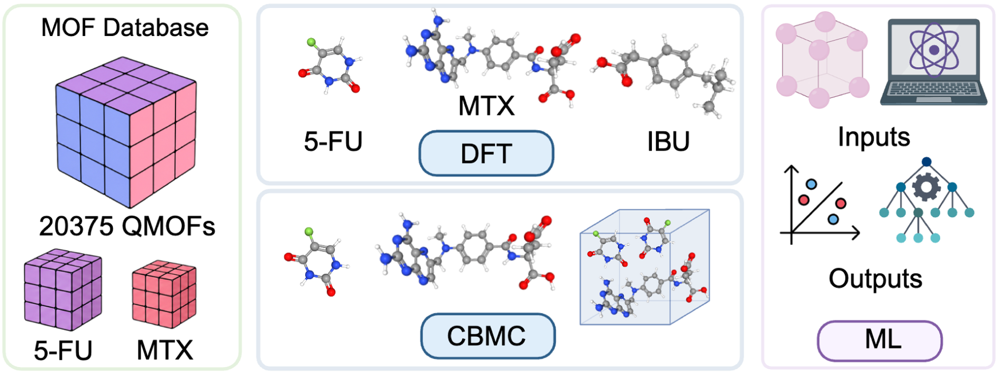

# Machine Learning-Accelerated Discovery of MOFs for Storage and Delivery of Anticancer Drug Molecules
[](https://doi.org/10.1039/d6dd00223d)
[](https://doi.org/10.5281/zenodo.21340484)

<p align="center">
  
</p>

## Overview

We combine molecular simulations with machine learning (ML) to predict the adsorption of anticancer drugs in metal–organic frameworks (MOFs). ML models were developed to predict:

1. single-component **5-FU** adsorption using MOF structural features,
2. single-component **MTX** adsorption using MOF structural features,
3. single-component adsorption of **5-FU and MTX** using combined structural and DFT-based drug features,
4. **co-adsorption of an equimolar 5-FU/MTX mixture** using combined structural and DFT-based features.

Models trained on combined structural and DFT-based features were transferred to 87,691 unseen hypothetical MOFs (5-FU) and 16,554 hypothetical MOFs (MTX), and further tested on an **unseen drug molecule (ibuprofen)** across 500 QMOFs. ML predictions were also compared with experimental data from the literature.

## Repository contents

| Path | Description |
|---|---|
| `raw_data.xlsx` | Complete dataset: molecular simulation results (drug uptakes) and all computed MOF structural and DFT-based drug features. |
| `Original Label Sheets/` | Model-ready Excel files used to train the ML models, one per prediction task. Columns are the input features; the last column is the target (e.g., 5-FU uptake at 1 bar). |
| `Models/` | Best ML pipelines identified by TPOT for each prediction task (`.py`). |
| `TPOT Input Parameters.csv` | Settings used for the TPOT pipeline search. |
| `media/` | Figures used in this README. |

## ML workflow

- **Model selection:** The Tree-based Pipeline Optimization Tool ([TPOT](https://epistasislab.github.io/tpot/archived/) v0.12.2) was used to select regression algorithms from scikit-learn and tune their hyperparameters.
- **TPOT settings:** 10 generations, population size 30, 5-fold cross-validation, `random_state = 42`.
- **Data split:** Stratified sampling into 80% training and 20% test sets to keep feature distributions consistent.
- **Evaluation:** R², RMSE and MAE against molecular simulation results.
- **Interpretability:** SHapley Additive exPlanations (SHAP) analysis to quantify the magnitude and direction of feature contributions.

- This repository has been archived on Zenodo. The archived version associated with the manuscript is available at: https://doi.org/10.5281/zenodo.21340484

## Citation

For more technical details, please refer to our [paper](https://doi.org/10.1039/d6dd00223d). If you use this code or data in your research, please cite:

```bibtex
@article{gulbalkan2026mofdrug,
  title={Machine learning-accelerated discovery of MOFs for storage and delivery of anticancer drug molecules},
  author={Gulbalkan, Hasan Can and Keskin, Seda},
  journal={Digital Discovery},
  volume={5},
  number={8},
  pages={3420--3434},
  year={2026},
  publisher={Royal Society of Chemistry},
  doi={10.1039/d6dd00223d}
}
```
